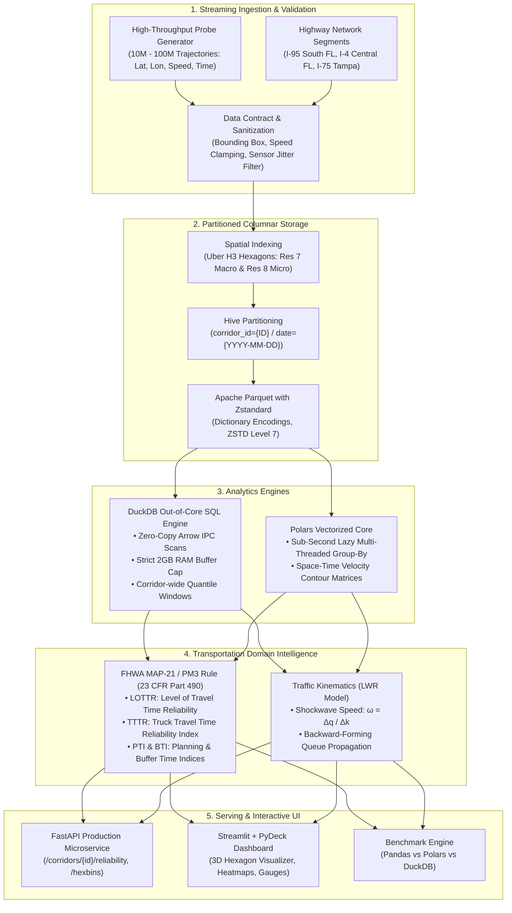

# US-Scale Mobility Data Pipeline

[](https://www.python.org/)
[](https://duckdb.org/)
[](https://pola.rs/)
[](https://arrow.apache.org/)
[](https://h3geo.org/)
[](https://fastapi.tiangolo.com/)
[](https://streamlit.io/)
[](LICENSE)
[-success.svg)](tests/)

> **High-Performance Columnar Architecture for 100M+ Trajectory Records**  
> Vectorized probe ingestion, Hive-partitioned Apache Parquet storage, Uber H3 spatial indexing, and automated Federal Highway Administration (FHWA) MAP-21 system reliability analytics.

---

## 1. Overview & Problem Context

State Departments of Transportation (DOTs) and Metropolitan Planning Organizations (MPOs) process massive streams of GPS probe, connected vehicle (CV), and telematics datasets (e.g., INRIX, HERE, TomTom, Wejo) to monitor highway congestion and comply with federal performance rules.

However, standard analytical pipelines built on in-memory Python (`pandas`, `geopandas`) or heavy relational spatial databases (`PostGIS`) break down when scaling past tens of millions of records:
- **Severe Memory Bloat**: Pandas object memory overhead frequently triggers fatal Out-Of-Memory (OOM) crashes.
- **Spatial Join Bottlenecks**: Continuous R-Tree polygon intersections impose steep $O(N \log M)$ latency.
- **Cluster Overhead**: Spark/Hadoop clusters entail high infrastructure cost, JVM tuning, and cluster coordination latency.

This repository implements a **single-node out-of-core columnar architecture** capable of streaming, filtering, spatially indexing, and aggregating **over 100,000,000 trajectory records** on commodity hardware with sub-second execution times and strictly bounded memory limits.

---

## 2. System Architecture



---

## 3. Empirical Performance Benchmarks (10,000,000 Records)

Comparative benchmark aggregating 10 million probe records across corridor segments and hourly bins on Apple Silicon (single-node, commodity hardware):

| Engine | Execution Latency | Peak Memory (RSS) | Relative Speedup | Memory Efficiency | Status |
| :--- | :--- | :--- | :--- | :--- | :--- |
| **DuckDB (Out-of-Core Columnar SQL)** | **0.318 s** | **102.5 MB** | **3.8x** | **12.9x Less RAM** | Completed |
| **Polars (Lazy Vectorized Rust)** | **0.303 s** | **110.2 MB** | **4.0x** | **12.0x Less RAM** | Completed |
| **Pandas (In-Memory Object Model)** | **1.213 s** | **1,319.7 MB** | 1.0x (Baseline) | Baseline (1.32 GB) | Completed |

> **Key Finding**: DuckDB and Polars execute analytical corridor quantiles in ~300 milliseconds while consuming only ~100 MB of RAM. Pandas consumes **1,319 MB (1.32 GB)** and takes 4x longer. At 100M rows, Pandas triggers fatal OOM exceptions on standard machines, while DuckDB streams predictably within a 2GB memory cap.

---

## 4. Mathematical Formulation & Federal Standards

### 4.1 FHWA MAP-21 / PM3 Rule (23 CFR Part 490)

#### Level of Travel Time Reliability (LOTTR) - 23 CFR § 490.511
For highway segment $i$ and federal time period $p$:
$$\text{LOTTR}_{i,p} = \frac{TT_{i,p, 80\text{th}}}{TT_{i,p, 50\text{th}}}$$

Evaluated across four federal time periods:
1. **AM Peak**: Weekdays 06:00 – 10:00
2. **Midday**: Weekdays 10:00 – 16:00
3. **PM Peak**: Weekdays 16:00 – 20:00
4. **Weekend**: Saturdays & Sundays 06:00 – 20:00

$$\text{Reliable Segment Criteria}: \quad \max_{p} (\text{LOTTR}_{i,p}) < 1.50$$

#### Truck Travel Time Reliability (TTTR) - 23 CFR § 490.611
Freight reliability monitors the 95th percentile tail risk across five federal periods:
$$\text{TTTR}_{i,p} = \frac{TT_{i,p, 95\text{th}}}{TT_{i,p, 50\text{th}}}$$

$$\text{System TTTR Index} = \frac{\sum_{i=1}^N \left( L_i \times \max_{p} \text{TTTR}_{i,p} \right)}{\sum_{i=1}^N L_i}$$

#### Planning Time Index (PTI) & Buffer Time Index (BTI)
$$\text{PTI} = \frac{TT_{95\text{th}}}{TT_{\text{free\_flow}}}, \qquad \text{BTI} = \frac{TT_{95\text{th}} - \overline{TT}}{\overline{TT}} \times 100\%$$

### 4.2 Lighthill-Whitham-Richards (LWR) Kinematic Shockwaves
Shockwave propagation velocity between upstream state 1 and queue bottleneck state 2:
$$\omega = \frac{\Delta q}{\Delta k} = \frac{q_2 - q_1}{k_2 - k_1} = \frac{k_2 v_2 - k_1 v_1}{k_2 - k_1}$$

Using Greenshields model: $k = k_{\text{jam}} \left( 1 - \frac{v}{v_{\text{ff}}} \right)$. A negative wave velocity ($\omega < 0$) quantifies the speed at which congestion backs up upstream.

---

## 5. Repository Structure

```text
us-mobility-data-pipeline/
├── README.md                          # Repository documentation
├── pyproject.toml                     # Modern build and dependency specifications
├── requirements.txt                   # Locked dependencies
├── .gitignore
├── app.py                             # Interactive Streamlit + PyDeck dashboard
├── src/
│   ├── __init__.py
│   ├── config.py                      # Corridor geometry, H3 parameters, federal periods
│   ├── generator.py                   # High-throughput calibrated probe stream generator
│   ├── etl.py                         # Data contract validation, H3 indexing, Hive Parquet writer
│   ├── duckdb_engine.py               # Out-of-core DuckDB SQL engine & Arrow memory bridge
│   ├── polars_engine.py               # Polars multi-threaded space-time matrix calculator
│   ├── reliability_metrics.py         # FHWA MAP-21 (LOTTR, TTTR, PTI, BTI) & LWR shockwaves
│   ├── benchmark.py                   # Benchmark suite (Pandas vs Polars vs DuckDB)
│   └── api.py                         # FastAPI production REST microservice
├── tests/
│   ├── __init__.py
│   └── test_pipeline.py               # Pytest suite covering ETL, queries, metrics, and API
├── docs/
│   └── methodology_and_architecture.md# Deep technical & mathematical specification
└── benchmarks/
    └── results_summary.md             # Benchmark execution metrics and profiling records
```

---

## 6. Quickstart & Usage

### 6.1 Installation
```bash
git clone git@github.com:dy-chang/us-mobility-data-pipeline.git
cd us-mobility-data-pipeline

# Create and activate virtual environment
python3 -m venv .venv
source .venv/bin/activate

# Install dependencies
pip install -e .
```

### 6.2 Running the Benchmark Suite
Benchmark performance across 1,000,000 or 10,000,000 records:
```bash
# 1 Million records
python src/benchmark.py --rows 1000000 --corridor I-95_MIA

# 10 Million records
python src/benchmark.py --rows 10000000 --corridor I-95_MIA
```

### 6.3 Launching the Interactive Streamlit Dashboard
```bash
streamlit run app.py
```
- **3D Spatial Hexagons**: View GPU-accelerated PyDeck hexagonal density & speed drops.
- **Space-Time Contours**: Inspect 15-minute speed matrices along corridor segments.
- **FHWA MAP-21 Compliance**: Review pass/fail status for all federal time periods.
- **LWR Shockwave Simulator**: Simulate bottleneck propagation speeds in real-time.

### 6.4 Starting the FastAPI REST Service
```bash
uvicorn src.api:app --host 0.0.0.0 --port 8000 --reload
```
Interactive API documentation available at: `http://localhost:8000/docs`

Key endpoints:
- `GET /corridors`: List configured corridors and bounding boxes.
- `GET /corridors/{id}/reliability`: Summary of LOTTR compliance %, TTTR index, and PTI/BTI.
- `GET /corridors/{id}/lottr`: Segment-by-segment LOTTR across 4 federal periods.
- `GET /corridors/{id}/hexbins?resolution=res7`: Uber H3 spatial density and speed aggregation.
- `GET /physics/shockwave?upstream_speed_mph=65&downstream_speed_mph=20`: Calculate shockwave speed.

### 6.5 Running Automated Tests
```bash
pytest tests/ -v
```

---

## 7. License
Distributed under the MIT License. See `LICENSE` for details.
